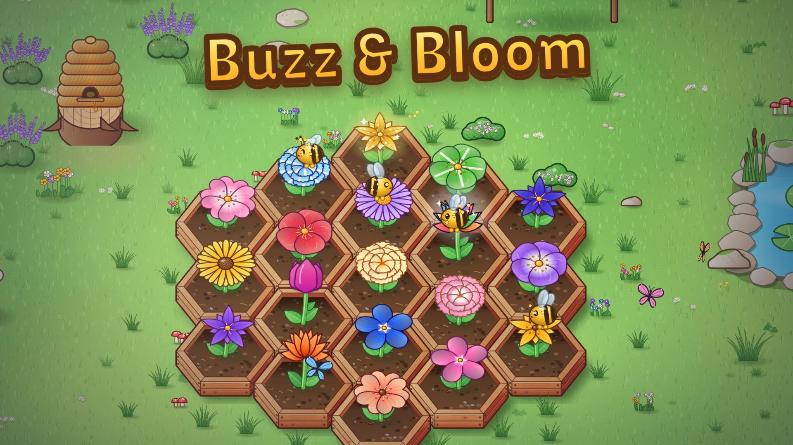

# Buzz & Bloom

A cozy, hand-illustrated 2D garden game for **CrazyGames**. Plant flowers in wooden hex planters, carry pollen
from bloom to bloom to breed brand-new hybrids (your bees cross neighbours too), tap sprouts to make them grow,
harvest quickly for combos, discover all 128 species for the Flower Book, fill cute visitors' orders, catch the
odd golden bee and decorate your garden. There's no fail state and nothing punishes you, and the garden keeps
growing while you're away.



## Play it locally

```bash
npm install
npm run dev          # http://localhost:8080  (esbuild dev server, rebundles on every request)
```

Useful URL parameters: `?reset` wipes the save, `?quality=low|medium|high` pins a quality tier, `?debug`
exposes `window.__game.debug` (coins, levels, weather, freeze/step/sim) in production builds.

Controls (touch or mouse):

- **Plant**: drag a seed from the pouch onto soil, or tap the seed and then the soil (drag across beds to plant several).
- **Grow**: tap a growing plant; each tap speeds it up (a ring shows its progress). Swipe across plants to boost them all.
- **Cross**: drag from one bloom onto another. A pollen trail follows your finger and a hybrid seed pops out; both
  blooms rest for a few seconds. Bees also cross neighbouring blooms on their own.
- **Harvest**: tap a bloom. Quick taps in a row make a combo (up to ×2 coins).
- **Collect**: tap the seed bubbles (they fly into the pouch by themselves after a moment).
- **Look around**: drag the lawn; pinch or mouse wheel to zoom. The view drifts back to the garden after a few seconds.
- Keyboard: `1-9` pick seeds, `W` watering can, `D` shovel, `S` shop, `B` book, `Esc` closes panels.

New players get a spotlight tutorial (one action at a time, with a pointing hand), then a chain of starter quests.
Tapping the quest chip shows where to do the current quest.

## Build for CrazyGames

```bash
npm run build        # → dist/ (index.html, game.js, game.css, 2 fonts) and build/buzz-and-bloom-1.0.0.zip
```

Upload the zip, which has `index.html` at its root. The whole game is ~490 KB (≈185 KB gzipped) in 5 files,
all with relative paths. There are no image or audio assets: every flower, planter, prop, critter and UI icon
is painted procedurally with Canvas 2D at runtime, and all sound and music is synthesised with Web Audio.

## Tests & tools

```bash
npm test             # headless play-through: follows the tutorial's hand with real taps/drags, then the first quest (fails on any console error)
npm run shots        # beauty screenshots of a mature garden in every weather → shots/
node tools/shot.mjs --dist --only=desktop,phone,landscape,small --play   # same checks against dist/
node tools/covers.mjs                # store covers → covers/ (1920x1080, 800x1200, 800x800)
node tools/lab.mjs <scene>           # art lab sheets (flowers, variants, big, garden, props, built, ui) → shots/
npm run sim                          # headless economy simulation (balancing)
```

## How it's made

| Area | Where |
|---|---|
| Game rules: genetics, economy, garden simulation, hex grid | `src/game/` (pure logic, no rendering) |
| 2D renderer: stage, camera, cached ground layer, depth-sorted sprites | `src/art/stage.js` |
| Illustration code (flowers, planters, lawn, nature, built props, decor, critters, UI art) | `src/art/*.js` |
| Garden view (planters, plants, seed bubbles, bees, picking, framing) | `src/art/garden.js` |
| World (layout, pond, hive, decorations, ambient life), weather & light | `src/art/world.js`, `src/art/weather.js` |
| HTML UI (HUD, pouch, orders, shop, book, cards, tutorial) | `src/ui/`, `styles/game.css` |
| CrazyGames SDK wrapper, saves, events | `src/core/` |
| Procedural audio | `src/audio/` |

The art style is a vector-cartoon look: ink outlines in a deep shade of each colour (never black),
hue-shifted shading (shadows drift toward violet, highlights toward warm yellow), glossy highlights, soft
contact shadows, and a 3/4 top-down projection (`src/art/view3q.js`). Sprites are painted once per zoom level
and cached, with any repaints spread over a few frames. A frame costs about 1–2 ms even with software
rendering. Quality tiers (`low`/`medium`/`high`) change resolution, particle counts and ambient life, and
`auto` steps down if the frame rate drops.

Game design notes (genetics tables, economy numbers, progression) are in [DESIGN.md](DESIGN.md).

## CrazyGames requirements checklist

- **SDK v3**: the script tag is in `index.html` before the game. `init` → `loadingStart` → `loadingStop` →
  `gameplayStart` fire as soon as the garden is interactive. `gameplayStop`/`gameplayStart` wrap full-screen
  panels (shop, book, settings) and are *not* called on blur. `happytime` is used only for rare moments.
  `muteAudio` from the SDK settings overrides the game's own audio. Completion % reports Flower Book progress.
- **Basic Launch**: no ads anywhere (`ADS_ENABLED = false` in `src/config.js`), and nothing is gated behind an ad.
- **Saves**: the SDK Data module when available (localStorage fallback).
- **Size / files**: well under 50 MB (20 MB mobile), 5 files, relative paths only.
- **Mobile**: touch-first controls, portrait and landscape layouts, safe-area insets, no hover-only actions,
  legible at 800×450 / 821×462 (11 px text floor).
- **Browser hygiene**: no page scroll from the wheel, arrow keys or space; no context menu; text selection
  disabled; audio resumes on the first interaction (iOS); no fullscreen button (the platform provides one).
- **English** text throughout.

## Submission notes

1. Upload `build/buzz-and-bloom-1.0.0.zip` (run `npm run build` first).
2. In the submission form, choose **"Yes, using the Data Module"** for saving progress.
3. Tick **mobile support** (portrait + landscape both work) and confirm the game respects `muteAudio`.
4. Covers: `covers/cover-landscape-1920x1080.png`, `covers/cover-portrait-800x1200.png`,
   `covers/cover-square-800x800.png`. Only the title appears as text, as required.
5. Check the name "Buzz & Bloom" is unique on the portal before submitting.
6. Preview videos: `video/buzz-and-bloom-landscape.mp4` (1920×1080) and `video/buzz-and-bloom-portrait.mp4`
   (1080×1920), ~22 s, 30 fps, silent, real gameplay with a human-paced cursor/finger: crossing two blooms by
   dragging pollen, tap-to-grow into a new species, a harvest combo, catching a golden bee, a starry night,
   buying land and sowing, placing a windmill, and the whole garden under a rainbow. Re-record with
   `node tools/video.mjs` (add `--only=landscape|portrait`).
